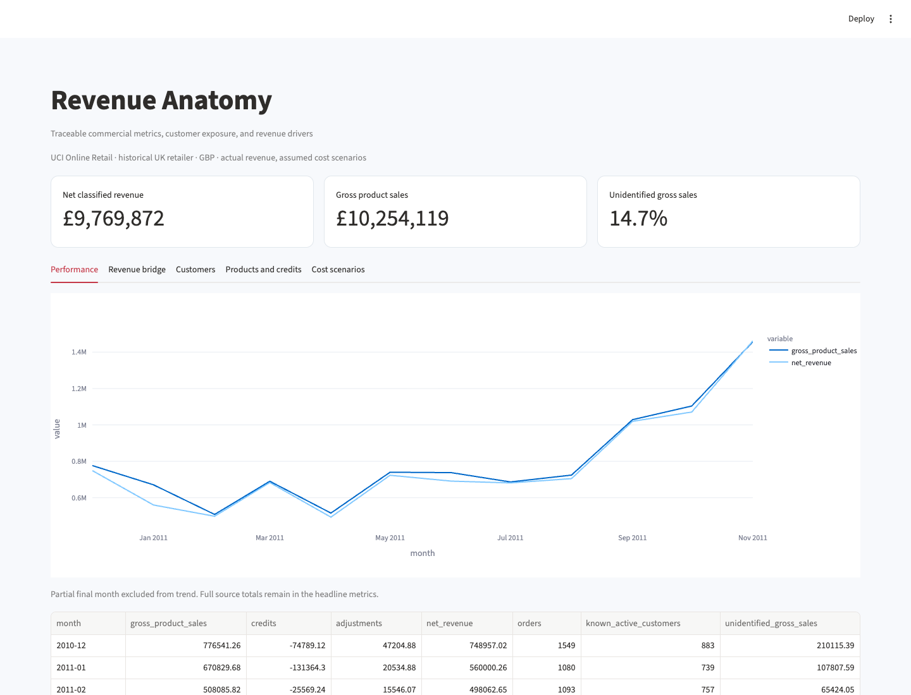

# Revenue Anatomy

A transaction-level commercial review that explains revenue movement, customer concentration, credits and repeat purchasing, with an exact revenue bridge and auditable SQL metrics.



## What it does

- Full UCI Online Retail ingestion with preserved duplicate flags and unknown-customer revenue.
- Explicit merchandise, credit, adjustment, zero-price and quarantine classifications.
- SQLite transaction model and executable SQL views for monthly/customer/product measures.
- Exact sequential volume–mix–price bridge with new/discontinued products and separate credit movements.
- Known-customer concentration, observed cohort activity and assumed-cost sensitivity.
- Streamlit exploration, formula-driven Excel model, five-slide management deck, PDF report and standalone charts.

## Run locally

Python 3.12 is the tested runtime.

```bash
python3 -m venv .venv
source .venv/bin/activate
python -m pip install -e '.[dev]' -c constraints.txt
revenue-anatomy run
streamlit run app.py --server.port 8515
```

Run these commands from this repository. For a non-editable installation or a different working
directory, set `PROJECT_ROOT` to the repository path. Raw downloads, local models and processed
datasets are ignored by Git; the run command regenerates them. Reports are included for review.
Network access is required for first-time public-data/model downloads where applicable.

`constraints.txt` records the dependency versions used in local validation. It is a tested version
constraint set, not a cross-platform hash lock. Ordinary dependency resolution still handles
platform-specific packages. Runtime dependencies are declared in `pyproject.toml`.

## Inspect the evidence

- analysis.pdf — evidence, recommendations and limitations
- reconciliation.json — source/classified/quarantined totals and bridge controls
- monthly_metrics.csv, customer_metrics.csv, product_metrics.csv — SQL-derived measures
- revenue_bridge.csv — exact movement decomposition
- cohort_retention.csv — observed repeat purchasing
- commercial_review.xlsx — editable management model
- management_review.pptx — five-slide decision presentation
- monthly_revenue.html and revenue_bridge.html — standalone charts

Outputs live in `reports/`. [Read the generated analysis](reports/analysis.md),
[methodology](docs/methodology.md), [data dictionary](data/README.md),
and [validation record](docs/validation.json).

## Data and scope

Chen, D. (2015), Online Retail, UCI dataset 352, DOI 10.24432/C5BW33, CC BY 4.0. All 541,909 rows from a UK-based non-store retailer, December 2010–December 2011. Prices are GBP. Product costs, payment collections, marketing spending, true acquisition dates and causal elasticities are unavailable. Cost scenarios are explicitly assumed.

Per-source download records store hashes and timestamps. A pre-existing local download is
identified as such if its original retrieval time was not captured. `data/provenance.json`
records the dataset and treatment assumptions. Refresh public sources explicitly when needed;
refreshing can change results.

## Walkthrough

1. Start with the data reconciliation and note the two negative-price rows quarantined from classified revenue.
2. Compare October and November 2011 in the exact revenue bridge, then select another complete-month pair.
3. Inspect customer concentration alongside unidentified customer sales.
4. Review high credited-value products without assuming credits establish product defects.
5. Change cost and fulfilment assumptions; observe that contribution is a scenario rather than observed profit. Open the Excel model and five-slide deck.

## Validate

```bash
python -m pytest -q
python -m ruff check src tests
python scripts/verify_artifacts.py
```

Unit tests use small, interpretable fixtures. Artifact verification checks reconciliations,
report/workbook structure and generated-file hashes. Generate the data before running the
artifact verifier. The validation record distinguishes executed checks from deployment configuration.

## Container

After generating the project data, build from this repository:

```bash
docker build -t revenue-anatomy:local .
docker run --rm -p 127.0.0.1:8515:8501 revenue-anatomy:local
```

The build copies generated local inputs so the application can open them. Rebuild after
regeneration. Docker configuration does not itself establish a hosted deployment. Development
servers bind to local ports in these examples.

## Layout

```text
src/revenue_anatomy/     analytical code, CLI and application
tests/                correctness and boundary fixtures
data/                 provenance, dictionary and regenerable inputs
reports/              measured results and shareable artifacts
docs/                 methodology, preview and validation evidence
scripts/              standalone artifact verification
```
